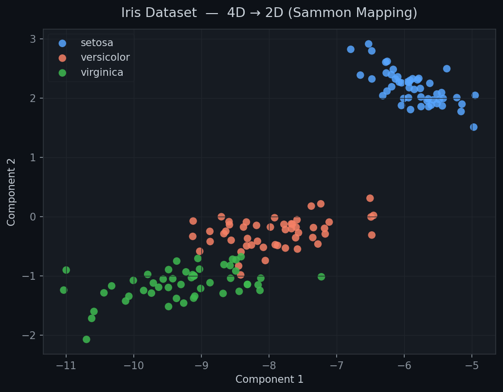
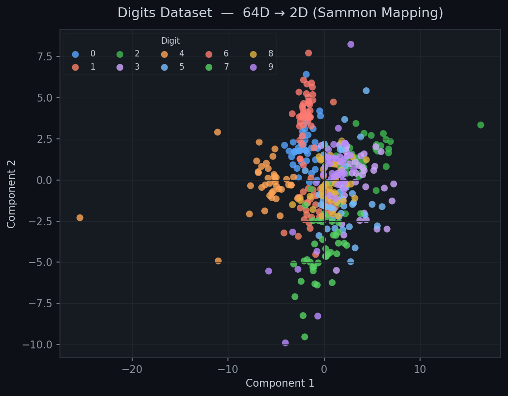
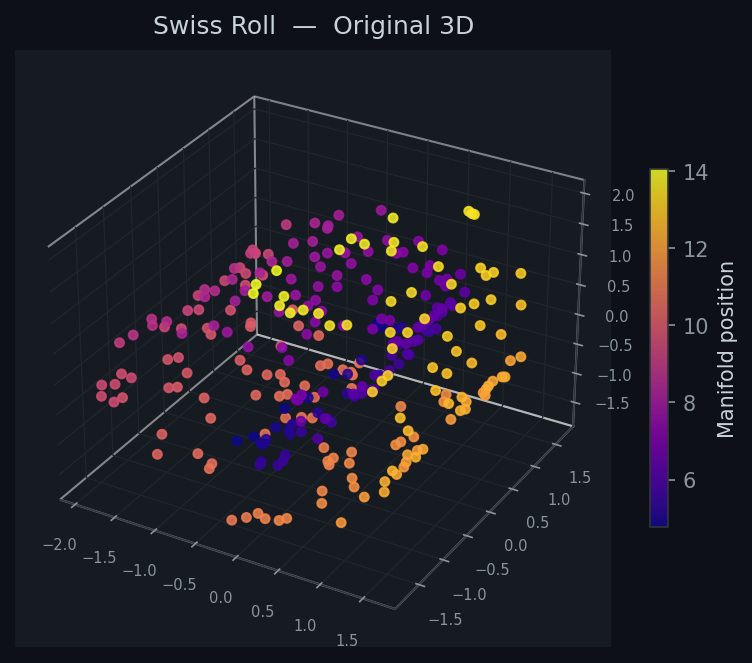
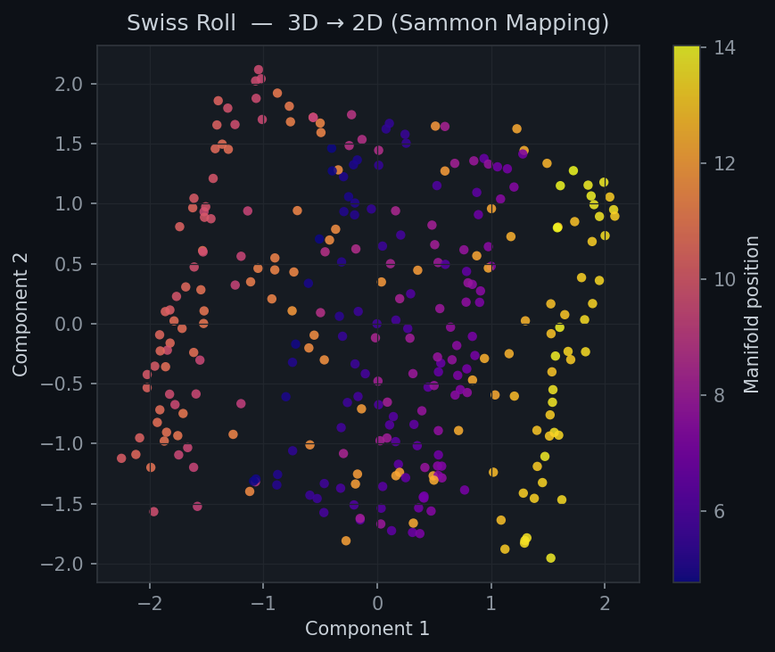

# Sammon Mapping

[](https://pypi.python.org/pypi/sammon-mapping/)
[](https://pypi.python.org/pypi/sammon-mapping/)
[](http://makeapullrequest.com)

A Python implementation of **Sammon Mapping** — a nonlinear dimensionality reduction technique that preserves pairwise distances between data points as faithfully as possible when projecting from a high-dimensional space into a lower-dimensional one.

Originally introduced by John W. Sammon Jr. in 1969, it is particularly effective at revealing cluster structure and manifold geometry that linear methods like PCA can miss.

---

## Features

- Reduce data of **any dimensionality** down to *n* dimensions (2D, 3D, …)
- Two **initialisation strategies**: PCA (default, faster convergence) or random
- Accepts either **raw data** or a **precomputed distance matrix** as input
- Step-halving line search for robust convergence
- Configurable iteration budget, step-halving depth, and convergence tolerance
- Returns the **stress value** so you can quantitatively compare runs

---

## Installation

```bash
pip install sammon-mapping
```

---

## Quick Start

```python
from sammon.sammon import sammon
from sklearn.datasets import load_iris
import matplotlib.pyplot as plt

iris = load_iris()
y, stress = sammon(iris.data, n=2)

plt.scatter(y[:, 0], y[:, 1], c=iris.target, cmap='tab10')
plt.title(f'Iris — Sammon Mapping  (stress={stress:.4f})')
plt.show()
```

---

## Visualizations

### Iris Dataset — 4D → 2D



### Handwritten Digits — 64D → 2D



### Swiss Roll Manifold — 3D → 2D

| Original 3D | Sammon 2D Projection |
|:-----------:|:-------------------:|
|  |  |

---

## API Reference

```python
sammon(x, n=2, display=0, inputdist='raw', maxhalves=20, maxiter=500, tolfun=1e-9, init='pca')
```

| Parameter | Type | Default | Description |
|-----------|------|---------|-------------|
| `x` | array-like `(N, D)` | — | Input data matrix or precomputed distance matrix |
| `n` | int | `2` | Number of output dimensions |
| `display` | int | `0` | Verbosity: `0` silent, `1` convergence message, `2` every iteration |
| `inputdist` | str | `'raw'` | `'raw'` — compute Euclidean distances from data; `'distance'` — `x` is already a distance matrix |
| `maxhalves` | int | `20` | Maximum step-halving attempts per iteration |
| `maxiter` | int | `500` | Maximum number of gradient descent iterations |
| `tolfun` | float | `1e-9` | Convergence tolerance on relative change in stress |
| `init` | str | `'pca'` | Initialisation: `'pca'` uses leading SVD components; `'random'` uses Gaussian noise |

**Returns**

| Name | Type | Description |
|------|------|-------------|
| `y` | ndarray `(N, n)` | Projected coordinates in the output space |
| `E` | float | Final Sammon stress (lower is better) |

---

## Examples

### Using a precomputed distance matrix

```python
from scipy.spatial.distance import cdist
from sammon.sammon import sammon

D = cdist(X, X)  # or any custom distance matrix
y, stress = sammon(D, n=2, inputdist='distance')
```

### 3D projection with verbose output

```python
y, stress = sammon(X, n=3, display=2)
```

### Random initialisation

```python
y, stress = sammon(X, n=2, init='random')
```

---

## Reference

Sammon, J. W. (1969). **A nonlinear mapping for data structure analysis.**
*IEEE Transactions on Computers*, C-18(5), 401–409.
doi: [10.1109/T-C.1969.222678](https://doi.org/10.1109/T-C.1969.222678)
